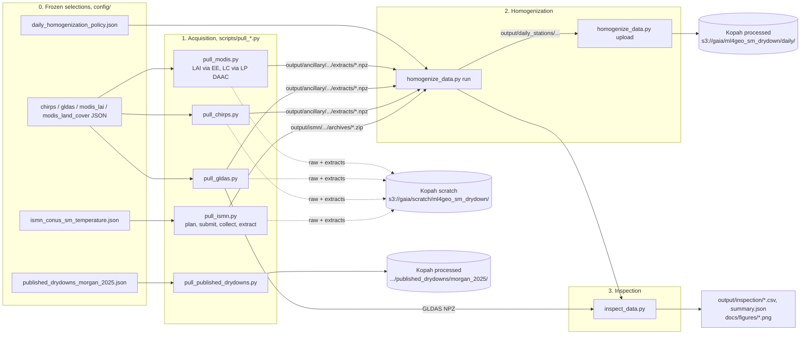

# Data workflow

This document walks through the repository's data pipeline from end to end: what each stage reads, what it writes, which rules it applies and how to rerun it. It describes the code as of commit `bb86058`. Results and scores are reported in the [README](../README.md) and the [AI-ready data report](ai_ready_dataset.md). The scientific motivation is in the [proposal](proposal.md).

## 1. Scope

The pipeline builds a **daily, per-station feature table** for 1,388 ISMN soil-moisture stations in CONUS, covering **2002-07-04 through 2025-12-31 inclusive** (8,582 UTC calendar days). It also keeps a separate, unchanged copy of the **published Morgan et al. (2025) drydown events and fitted *q* labels**.

The current code does **not**:

- detect drydown events or fit loss functions. The `external/drydowns` and `external/ecflux` submodules are installed but never called;
- add PET to the daily tables. [scripts/download_gleam.sh](../scripts/download_gleam.sh) downloads GLEAM, but nothing downstream uses it (see [§10](#10-gaps-and-caveats));
- apply the spatial partitions to the tables. [config/spatial_partitions.json](../config/spatial_partitions.json) has the status "proposed; not applied";
- fill, interpolate or carry forward any measurement. Every stage records `values_filled: 0`.

## 2. Pipeline at a glance



| Stage | Entry point | Library code | Network | Main output |
| --- | --- | --- | --- | --- |
| 0. Selection | committed JSON in [config/](../config/) | n/a | none (already frozen) | station, sensor, date and asset lists |
| 1. Acquisition | `scripts/pull_*.py` | [src/sm_drydown/acquisition/](../src/sm_drydown/acquisition/) | provider APIs plus Kopah | raw provider bytes, station extracts, provenance |
| 2. Homogenization | [scripts/homogenize_data.py](../scripts/homogenize_data.py) | [src/sm_drydown/homogenization/](../src/sm_drydown/homogenization/) | none for `run`; Kopah for `upload` | one Parquet table and JSON description per station |
| 3. Inspection | [scripts/inspect_data.py](../scripts/inspect_data.py) | [src/sm_drydown/inspection/](../src/sm_drydown/inspection/) | none | diagnostic CSVs, `summary.json`, PNGs |
| 4. Catalog and partitions | [config/ai_ready_dataset.json](../config/ai_ready_dataset.json), [config/spatial_partitions.json](../config/spatial_partitions.json) | catalog helpers in [storage/catalog.py](../src/sm_drydown/storage/catalog.py) | n/a | dataset catalog and proposed folds |

## 3. Conventions shared by every stage

These conventions explain most of the code's structure, so they come before the stages themselves.

1. **Frozen configuration drives everything.** Each downloader reads only its own JSON file. That file lists every station, coordinate, date window, asset, granule URL and storage destination, so a run never discovers inventory at fetch time. The files reference one another by SHA-256. For example, every ancillary config's `station_snapshot` names the ISMN station snapshot it was derived from.

2. **Plan, approve by hash, then fetch.** Every `pull_*` script has a `plan` action. It runs offline, writes `plan.json` and prints the configuration's SHA-256. The `fetch`, `submit`, `collect` and `extract` actions refuse to run unless `--approved-config-sha256` matches that hash exactly. Any edit to a config therefore needs a fresh approval. The GLDAS plan also lists unresolved decisions (for example a missing `sensor_depth_assignment`) and blocks fetching until they are resolved.

3. **Validated, resumable caches.** [storage/files.py](../src/sm_drydown/storage/files.py) `download()` reuses a cached file only when its `.provenance.json` sidecar matches the URL and the SHA-256 (and, for ZIPs, the CRC). Otherwise it downloads again to a `.part` file, restarting from byte zero up to three times, and moves the file into place atomically. Earth Engine responses are cached the same way, as decoded JSON plus a sidecar recording the request. JSON is always written atomically and never with `NaN` (`allow_nan=False`).

4. **Immutable, private object storage.** `ObjectStore.upload()` stores the file's SHA-256 in the S3 object metadata. It skips an upload when an identical object already exists and **refuses to overwrite a different object at the same key**. It then checks the size and hash again after uploading. Objects are uploaded with `ACL: private`.

5. **Raw data and derived extracts are kept apart.** Unchanged provider bytes go under `raw/`. Station-cell extracts (`.npz`, with a `.json` metadata sidecar) go under `extracts/`. Provenance records go under `provenance/`, and a content-addressed completion record goes under `manifests/<config-sha>.json`, written only when every asset is complete.

6. **Scratch versus processed storage.** Raw acquisitions go to `s3://gaia/scratch/ml4geo_sm_drydown/`. Daily tables and the Morgan labels go to `s3://gaia/ml4geo_sm_drydown/`. The daily and published uploaders reject any destination whose path contains `scratch`.

7. **Missing stays missing.** Each derived column has a `__missing_reason` companion column, so the cause of every null can be traced: no observations, quality-masked, provider null, absent row, missing QC, missing static value, or no source interval.

8. **Native-cell sampling.** Gridded products are sampled at the native pixel that contains each station, with no resampling. CHIRPS and MODIS use half-open affine pixels with floor indexing. GLDAS uses the nearest grid centre, with exact ties going to the larger coordinate.

## 4. Prerequisites

| Need | Used by | Notes |
| --- | --- | --- |
| [Pixi](https://pixi.sh) environment (`pixi install`) | everything | [pixi.toml](../pixi.toml) currently lists only `osx-arm64`; see [§10](#10-gaps-and-caveats) |
| Submodules (`git submodule update --init --recursive`) | environment solve | `drydowns` and `ecflux` are editable PyPI dependencies |
| Kopah S3 profile `kopah`, endpoint `https://s3.kopah.uw.edu` | every `fetch`/`collect`/`extract`/`upload`, and `restore_from_kopah.py` | set up per the [skypilot-hyak Kopah instructions](https://github.com/gaia-hazlab/skypilot-hyak/blob/main/docs/kopah.md) |
| ISMN account; `~/.config/ismn/credentials.toml` with `username`/`password`, mode `600` | `pull_ismn.py submit/collect` | the client refuses group- or world-readable credential files |
| Earth Engine authentication and a Cloud project (`--project`) | `pull_chirps.py fetch`, `pull_modis.py fetch` (LAI) | the client is created lazily, so planning and cache reuse need no auth |
| Earthdata Login; `~/.earthdata/config` with `USER=`/`PASS=` lines, mode `600` | `pull_modis.py fetch` (land cover) | credentials are sent only to the Earthdata Login host on redirects |
| Public HTTPS | GLDAS, Morgan | no account needed |

`homogenize_data.py run` and `inspect_data.py` work **only from local caches**. They need no credentials, but they do need completed acquisition caches under `output/`.

## 5. Stage 0: frozen selections

| File | Role |
| --- | --- |
| [ismn_conus_sm_temperature.json](../config/ismn_conus_sm_temperature.json) | Master selection: 1,388 stations in 14 networks, each SM sensor's `timeseries_id`, depth (m) and active interval, the requested variables (`soil_moisture`, `precipitation`, `soil_temperature`), the provider export options and the storage destination. CONUS is defined as the 48 states plus DC, using the Census 2025 5 m boundary buffered by 0.005°. The ISMN station inventory and the boundary file are recorded with retrieval time and SHA-256 under `sources`. Stations with no SM interval in the window are listed in `stations_without_sm_in_window`. |
| [chirps_earthengine_conus.json](../config/chirps_earthengine_conus.json) | Earth Engine collection `UCSB-CHG/CHIRPS/DAILY`, band `precipitation` (mm/day), 24 annual assets, and a request bound of 900,000 values (Earth Engine's limit is 1,048,576) with one request at a time. |
| [gldas_soils_conus.json](../config/gldas_soils_conus.json) | Five static GLDAS 0.25° NetCDF files (texture, sand, silt, clay, porosity) with HTTPS URLs and variable names, plus `sensor_depth_assignment: top_layer_through_50cm` and each station's sensor depths. |
| [modis_lai_conus.json](../config/modis_lai_conus.json) | Earth Engine collection `MODIS/061/MCD15A3H` (4-day), all six bands, 24 annual assets. MCD15A3H replaces the proposal's MCD15A2H because Earth Engine does not offer the 8-day collection. |
| [modis_land_cover_conus.json](../config/modis_land_cover_conus.json) | MCD12Q1 v6.1 annual HDF4 granules from LP DAAC, all 13 bands, with every granule URL, CMR ID and tile frozen per year. It supersedes an Earth Engine version whose 2025 image lacked Western Hemisphere tiles. |
| [published_drydowns_morgan_2025.json](../config/published_drydowns_morgan_2025.json) | 19 files pinned to `ecohydro/ismn-drydowns@ece5bbc5d741`, each with a SHA-256, plus the CSV member name, its hash and a column description. `homogenize: false`. |
| [daily_homogenization_policy.json](../config/daily_homogenization_policy.json) | Every decoding and QC decision that homogenization needs (see [§7.3](#73-per-variable-rules)). |
| [source_provenance.json](../config/source_provenance.json), [ismn_network_provenance.json](../config/ismn_network_provenance.json), [ismn_network_references.bib](../config/ismn_network_references.bib) | Rights, citations, retrieval records and per-network archive hashes. |

None of these selections can be regenerated from the repository; see [§10](#10-gaps-and-caveats).

## 6. Stage 1: acquisition

Each fetcher writes a local cache under `--cache-dir` and mirrors it to Kopah scratch under `<dataset>/<collection_id>/`. All of them reuse valid cached work, so an interrupted run can simply be repeated.

### 6.1 ISMN soil moisture, soil temperature and precipitation

Script: [scripts/pull_ismn.py](../scripts/pull_ismn.py). Code: [ismn.py](../src/sm_drydown/acquisition/ismn.py), [ismn_workflow.py](../src/sm_drydown/acquisition/ismn_workflow.py), [ismn_extract.py](../src/sm_drydown/acquisition/ismn_extract.py).

ISMN exports are asynchronous, so the workflow has four actions:

1. **`plan`**: validates the selection offline. It checks for unique stations and sensors, that each sensor overlaps the window, and that the provider depth range keeps every sensor. It also enforces `format: own` (native header+values), `fill_nan: false` and `g_flag_only: false`, so ISMN applies no filtering before export. It then writes one request payload per network to `output/ismn/<collection_id>/plan.json`.
2. **`submit`**: logs in by scraping the CSRF token (the provider's JavaScript is never run) and posts one export request per network. Submissions are spaced at least 61 s apart, because ISMN timestamps requests only to the minute and that timestamp is how each request is matched later. Each request's state is checkpointed in `requests/<network>.json`. A POST is **never retried**: if a previous attempt was interrupted while `submitting`, the script stops and asks for the ISMN requests page to be checked by hand, to avoid creating duplicate exports.
3. **`collect`**: reads the ISMN request list. For each ready export it downloads and checks the ZIP (`archives/<network>.zip` plus `.provenance.json`), uploads it to `ismn/<collection_id>/raw/<network>.zip` and records provenance. The script exits with status **2** while any export is still pending. `--wait --poll-interval N` (1–60 s) polls until all exports are ready. A full `manifests/<config-sha>.json` is uploaded only when every network in the selection has been collected.
4. **`extract`** (optional mirror): downloads each raw ZIP back from Kopah if the local copy is missing or invalid, unpacks it safely (rejecting path traversal, symlinks and duplicate members, and checking CRCs), and uploads the unchanged members to `ismn/<collection_id>/extracted/<network>/` with up to 8 concurrent uploads. **Homogenization does not use this step**; it reads the ZIPs directly.

Raw observation bytes are never parsed or changed during acquisition.

### 6.2 CHIRPS precipitation (Earth Engine)

Script: [scripts/pull_chirps.py](../scripts/pull_chirps.py). Code: [chirps.py](../src/sm_drydown/acquisition/chirps.py).

For each annual asset, the script fetches the image metadata (`ImageCollection.getInfo`) and caches it as `raw/<year>/images.json`. It then computes the unique native 0.05° cells containing the stations and requests `getRegion` in bounded, sequential batches (`raw/<year>/batch_NNNN.json`). Each response is checked for the expected columns and for exactly the expected images and cells. The decoded responses are then turned into `extracts/<year>.npz`, a float64 array of days × stations with **two separate boolean masks**: `null_mask`, where the provider returned null, and `absent_row_mask`, where the provider returned no row. Zero rainfall and missing rainfall are never merged. The cache keeps decoded Earth Engine JSON, not the original UCSB NetCDF files.

### 6.3 GLDAS static soil properties (HTTPS)

Script: [scripts/pull_gldas.py](../scripts/pull_gldas.py). Code: [gldas.py](../src/sm_drydown/acquisition/gldas.py), [grid.py](../src/sm_drydown/acquisition/grid.py), [formats/cf.py](../src/sm_drydown/formats/cf.py).

The script downloads each native NetCDF4 file unchanged, after checking that it is HDF5/NetCDF. It reuses byte-identical files from earlier collection IDs when the URL and hash match. `extract_native_cells()` then reads only the HDF5 chunks that contain station cells and writes `extracts/<asset>.npz` with the **unscaled, encoded** values and native cell indices. The `.json` sidecar records the CF attributes (`_FillValue`, `scale_factor`, and so on) and the HDF5 creation fill properties. Decoding is postponed to homogenization, which applies the NetCDF default fill only when it can be verified (see `verified_default_fill`).

### 6.4 MODIS LAI (Earth Engine) and land cover (LP DAAC)

Script: [scripts/pull_modis.py](../scripts/pull_modis.py). The config's `strategy` selects the backend:

- **LAI, `earth_engine_getRegion`** ([modis.py](../src/sm_drydown/acquisition/modis.py)): the same caching and batching as CHIRPS, on the MODIS sinusoidal grid (`SR-ORG:6974`, R = 6,371,007.181 m). The script checks that source grids align within each year and records each composite as a `[start, end)` interval of 4 days, **cut at 1 January** so that no interval crosses a year boundary. All six bands are kept raw, with no QC masking or scaling.
- **Land cover, `lpdaac_https_hdf4`** ([lpdaac.py](../src/sm_drydown/acquisition/lpdaac.py)): downloads each frozen HDF4 tile (2400 × 2400 pixels at 500 m) with Earthdata authentication. It checks the HDF4 magic bytes and that the tile's grid boundaries match the configured native lattice, reads all 13 uint8 bands at the station pixels, and writes one annual extract. It refuses a year in which the primary band has no valid values at all, but keeps individual stations whose values are missing.

### 6.5 Published Morgan et al. (2025) events and labels

Script: [scripts/pull_published_drydowns.py](../scripts/pull_published_drydowns.py). Code: [published.py](../src/sm_drydown/acquisition/published.py).

The script downloads the 19 pinned files, each checked against its SHA-256 in the config, and unpacks the single CSV member (`ismn_results_star_th0_04may.csv`, 228,012 events, label column `q_q`), checking that hash as well. It uploads the source files, provenance, CSV, config and a content-addressed manifest to `s3://gaia/ml4geo_sm_drydown/published_drydowns/morgan_2025/<commit>/`. The data are neither parsed nor linked to the daily tables.

### 6.6 Helper scripts outside the main pipeline

- [scripts/upload_to_kopah.sh](../scripts/upload_to_kopah.sh): a minimal `curl` plus `s5cmd cp` example for fetching one HTTPS file into Kopah from Hyak (see the README).
- [scripts/restore_from_kopah.py](../scripts/restore_from_kopah.py) ([storage/restore.py](../src/sm_drydown/storage/restore.py)): the reverse of acquisition, for working offline from existing scratch objects. It downloads the ISMN `raw/<network>.zip` and `provenance/<config-sha>/<network>.json` objects and every configured ancillary `extracts/<asset>.npz` and `.json`, then rebuilds `archives/<network>.zip.provenance.json` from the six fields `download()` originally wrote. Every file is checked against the SHA-256 in the object metadata, and cached files that already match are not downloaded again. Each cache folder gets a `restore.json` listing source URIs, hashes and restore times. Rebuilt sidecars are byte-identical to the originals, so the restored data inputs to a station's input signature are unchanged; the signature still differs from the published one whenever the hashed source files differ.
- [scripts/download_gleam.sh](../scripts/download_gleam.sh): mirrors GLEAM v4.3a/b (default variable `Ep`, potential evaporation) over SFTP with `lftp`. It is standalone, writes to a hard-coded path and is not read by any later stage.

## 7. Stage 2: homogenization into daily station tables

Script: [scripts/homogenize_data.py](../scripts/homogenize_data.py). Code: [homogenization/workflow.py](../src/sm_drydown/homogenization/workflow.py), [daily.py](../src/sm_drydown/homogenization/daily.py), [sources.py](../src/sm_drydown/homogenization/sources.py).

### 7.1 Inputs and checks before any computation

`run_homogenization()` ([workflow.py:89](../src/sm_drydown/homogenization/workflow.py#L89)) needs:

- the ISMN selection plus `output/ismn/<collection_id>/archives/<network>.zip`, each matching its acquisition sidecar hash;
- the four ancillary configs plus `output/ancillary/<collection_id>/extracts/*.npz` and `.json`, loaded and hash-checked by `ExtractCatalog`;
- `--policy`, **which has no default**. Pass `config/daily_homogenization_policy.json`. `_policies()` stops if any required decision is missing.

Before processing any station, it checks that every ancillary config uses the same date window as the ISMN selection, and that every station has the same network, latitude and longitude in every config.

### 7.2 Station bundle identity

For each station, it computes an **input signature**: the SHA-256 of a JSON record containing

- the selection hash and the policy hash;
- every source's config hash and asset metadata;
- the network archive hash and its sidecar hash;
- the station ID and network;
- the SHA-256 of each homogenization, format and storage source file.

The output goes to `output/daily_stations/<url-quoted network>/<station_id>/<signature>/`. If that folder already exists, it is re-checked and reused. Otherwise the table is built in a temporary directory and renamed into place in one step.

As a result, **changing any input, the policy or the homogenization code produces a new signature folder** next to the old one. The `upload` action and the inspection step both refuse a directory that holds more than one version for a station, so start a fresh `--output-dir` after code or policy changes.

### 7.3 Per-variable rules

All dates are UTC calendar days, stored as timezone-naive midnights. Coordinates are EPSG:4326.

| Variable | Source and reader | Rule | Column(s) and units |
| --- | --- | --- | --- |
| Soil moisture | ISMN `.stm` members matching `_sm_<depth>_<depth>_`, parsed by `read_station_sensors()` | Decode `NaN` (the policy declares no numeric sentinels). **Keep only observations flagged `G` by ISMN.** Take the mean of the accepted values within each UTC day, with no minimum count. Each sensor, depth and replicate gets its own column. Duplicate timestamps raise an error. | `sm_<16-hex>` in m³/m³; the suffix is the first 16 hex digits of the SHA-256 of the archive member path |
| Soil temperature | ISMN `_ts_` members | Same as soil moisture, with `temperature_quality: G_only` using the sensor's own flags. Kelvin is converted to °C. | `soil_temperature_<16-hex>` in °C |
| ISMN precipitation | requested in the export | **Excluded**: the reader skips every member that is neither `sm` nor `ts`. | none |
| Precipitation | CHIRPS NPZ | Aligned one-to-one with the daily grid, with no averaging. Provider nulls and absent rows stay distinct and are **never treated as zero rain**. | `chirps_precip_mm_day` in mm/day, plus `__provider_null` and `__provider_absent_row` |
| Soil texture and properties | GLDAS NPZ | CF-decoded. Percentages are converted to fractions, and any unrecognized unit raises an error. Fractions outside [0, 1] raise an error. Texture class values carrying float32 noise are snapped to the nearest integer within 1e-4; values further from an integer raise an error. The single static value is repeated on every day. | `gldas_soil_texture_class` (FAO 1–16, Int64); `gldas_sand_fraction`, `gldas_silt_fraction`, `gldas_clay_fraction`, `gldas_porosity` (dimensionless) |
| Land cover | MCD12Q1 extract | Band `LC_Type1` (IGBP). Fill and valid-range codes are decoded. QC mode is `retain_flagged`, so QC is recorded but does not mask values. Each annual value applies within its `[start, end)` interval. | `modis_land_cover` (Int64), plus `__source_start`, `__source_end_exclusive`, `__qc_QC`, `__qc_LW` |
| LAI | MCD15A3H extract | Band `Lai`. Fill and valid-range codes are masked **before** applying `scale_factor` (0.1). QC rule: bits 5–7 of `FparLai_QC` (SCF_QC) must equal 0 or 1, meaning the main algorithm, with or without saturation. A value with missing QC is never assumed good. Each value applies within its 4-day interval and never across a missing or rejected composite. | `modis_lai_m2_m2` in m²/m², plus interval and `__qc_FparLai_QC`/`__qc_FparExtra_QC` columns |

Each SM and temperature column also has these companion columns:

- `__observation_count`, `__good_flag_count`, `__valid_count`;
- `__ismn_flag_counts` and `__provider_flag_counts`: JSON histograms of the raw flag words for each day;
- `__missing_reason`: one of `available`, `missing_values`, `quality_masked` or `no_observations`.

### 7.4 Output bundle

Each station folder contains:

- `daily.parquet` (zstd), with one row per day for 8,582 days. Its schema metadata records `timezone`, `schema_version: 1` and `field_units`.
- `description.json`, which records:
  - the station's identity, the window, the policies and the input signature;
  - full source provenance and native source coordinates;
  - the MODIS and GLDAS decoding audits;
  - per-sensor metadata: depth, instrument, archive member hash, counts of values masked and missing;
  - the type of every column, missing counts and units;
  - `table_sha256`;
  - `fitting_performed: false` and `drydown_detection_performed: false`.

`validate_station_bundle()` re-checks the schema, the signature, the table hash and the row count every time a bundle is reused, inspected or uploaded.

### 7.5 Upload

`homogenize_data.py upload` calls `daily_manifest()` ([catalog.py:10](../src/sm_drydown/storage/catalog.py#L10)), which requires **exactly one** valid bundle for every selected station, matching the current selection hash and window. It then uploads only the files listed in the manifest, re-hashing each one first, to `s3://gaia/ml4geo_sm_drydown/daily/<network>/<station_id>/<signature>/`. `--upload-workers` sets the number of concurrent uploads (1–16, default 4). Finally it publishes `daily/manifests/<manifest-sha>.json`. The full verified run that is published in [ai_ready_dataset.json](../config/ai_ready_dataset.json) has 1,388 stations, 11,911,816 rows and 10,825 SM plus 8,632 temperature streams, about 9.3 GB in total.

`--network` and `--station-id` restrict both `run` and `upload` to a subset, which is useful for pilots.

## 8. Stage 3: inspection

Script: [scripts/inspect_data.py](../scripts/inspect_data.py). Code: [inspection/workflow.py](../src/sm_drydown/inspection/workflow.py), [checks.py](../src/sm_drydown/inspection/checks.py), [plots.py](../src/sm_drydown/inspection/plots.py).

Inspection only reads its inputs. It flags candidate problems; it does not change any data. It refuses to write inside the daily-input or ancillary-cache directories. It also checks that every bundle was built from the current selection and GLDAS config hashes and covers the full calendar grid.

| Check | Rule (CLI default) | Output |
| --- | --- | --- |
| ISMN quality masking | per sensor: source observations, decoded missing values, non-`G` values masked, `G` values accepted | `ismn_masked_counts.csv` |
| SM flatlines | maximal runs of **exactly equal** daily means on at least `--flatline-min-days` (3) consecutive dates; missing days and calendar gaps break a run | `ismn_flatlines.csv` |
| CHIRPS negatives | any finite value < 0 | `chirps_negative.csv` |
| CHIRPS extremes | values strictly above the station's empirical `--chirps-positive-quantile` (0.999) of days with rain; no comparison with neighbouring stations | `chirps_extremes.csv` |
| CHIRPS seasons | DJF/MAM/JJA/SON sums with coverage fractions; a "complete" total only when every day is finite; DJF is labelled with the year of its January | `chirps_seasonal_totals.csv` |
| GLDAS | fractions and porosity in [0, 1]; texture codes 1–16; \|sand+silt+clay − 1\| ≤ `--gldas-sum-tolerance` (0.01) | `gldas_checks.csv` |
| Per-station rollup | flatline runs, negative, extreme and missing CHIRPS days | `station_checks.csv` |
| Distributions | quantiles and means of finite values for SM sensor-days, and for CHIRPS, LAI and land cover weighted both by station and by unique native cell (MODIS counted once per source interval) | `summary.json` |
| Figures | SM and CHIRPS histograms | `docs/figures/ismn_sm_distribution.png`, `docs/figures/chirps_precip_distribution.png` |

Outputs go to `--output-dir` (default `output/inspection/`). Figures go to `--figure-dir` (default `docs/figures/`), so the figures used in the report can be committed.

## 9. Stage 4: catalog and spatial partitions

- [config/ai_ready_dataset.json](../config/ai_ready_dataset.json) is the hand-maintained catalog of the two published components (daily tables and Morgan labels). It records manifest URIs, counts, bytes and verification times, and the hashes of the provenance files.
- [config/spatial_partitions.json](../config/spatial_partitions.json) lists station IDs for a southern evaluation holdout (latitude < 35.25°N, 277 stations) and four development folds (NW, SW, NE, SE; 273–283 stations each), balanced by unique station ID with no buffer. `test_frozen_regions_cover_selection_once_and_share_no_native_soil_cells` in [tests/test_homogenization.py](../tests/test_homogenization.py) checks that the regions cover the selection exactly once and share no GLDAS cell. The regional tables in [ai_ready_dataset.md](ai_ready_dataset.md#spatial-regions) were derived from this file.

## 10. Gaps and caveats

Things to know before rerunning or extending the pipeline:

1. **Environment platform.** [pixi.toml](../pixi.toml) lists only `osx-arm64`, so `pixi install` will not solve on Linux, including Hyak/klone, until `linux-64` is added and the lockfile is regenerated. On klone, run homogenization and inspection in a Slurm job, not on a login node.
2. **Default directories do not match.** `homogenize_data.py` writes to `output/daily_stations` by default, but `inspect_data.py` reads `output/daily_stations_v1` by default. Pass `--daily-dir` explicitly.
3. **Selections cannot be regenerated.** No script in the repository rebuilds the frozen configs: the ISMN inventory query and CONUS clip, the ancillary station lists, the LP DAAC CMR inventory (`lpdaac.discover_year()` exists but no CLI calls it) or `spatial_partitions.json`. The ancillary configs' `station_snapshot.source_file` points to `config/ismn_conus.json`, which is not in the repository; the committed `ismn_conus_sm_temperature.json` declares that it supplements that collection.
4. **PET is missing.** The report lists PET as a planned feature with acquisition deferred. `download_gleam.sh` hard-codes `OUTPUT_ROOT=/glade/derecho/...` and embeds the SFTP login in the script, does not use the cache and provenance conventions, and uses 4 parallel connections.
5. **ISMN precipitation** is downloaded but deliberately left out of the daily tables.
6. **`.gitignore` has unresolved merge-conflict markers** (lines 46–53). Git reads those lines as patterns, so `output/` and `.vscode/` are still ignored, but the block should be cleaned up.
7. **`upload_to_kopah.sh` needs `s5cmd`**, which is not a Pixi dependency.
8. **Notebooks.** [notebooks/bbucho.ipynb](../notebooks/bbucho.ipynb) and [notebooks/mfris.ipynb](../notebooks/mfris.ipynb) are homework demos and are not part of the pipeline. `data/*-commands.txt` are shell logs.

## 11. End-to-end commands

Run from the repository root. Each `plan` prints a hash; review the plan, then pass that exact hash to the matching fetch step.

```sh
# environment
pixi install
pixi run smoke
pixi run test

# 1a. ISMN (asynchronous provider exports)
pixi run python scripts/pull_ismn.py plan
pixi run python scripts/pull_ismn.py submit  --approved-config-sha256 <ISMN_HASH>
pixi run python scripts/pull_ismn.py collect --approved-config-sha256 <ISMN_HASH> --wait
pixi run python scripts/pull_ismn.py extract --approved-config-sha256 <ISMN_HASH>   # optional Kopah mirror

# 1b. CHIRPS (Earth Engine)
pixi run python scripts/pull_chirps.py plan
pixi run python scripts/pull_chirps.py fetch --project <EE_PROJECT> --approved-config-sha256 <CHIRPS_HASH>

# 1c. GLDAS (HTTPS)
pixi run python scripts/pull_gldas.py plan
pixi run python scripts/pull_gldas.py fetch --approved-config-sha256 <GLDAS_HASH>

# 1d. MODIS LAI (Earth Engine) and land cover (LP DAAC)
pixi run python scripts/pull_modis.py plan  --config config/modis_lai_conus.json
pixi run python scripts/pull_modis.py fetch --config config/modis_lai_conus.json \
    --project <EE_PROJECT> --approved-config-sha256 <LAI_HASH>
pixi run python scripts/pull_modis.py plan  --config config/modis_land_cover_conus.json
pixi run python scripts/pull_modis.py fetch --config config/modis_land_cover_conus.json \
    --approved-config-sha256 <LC_HASH>

# 1e. Published Morgan labels (independent of everything else)
pixi run python scripts/pull_published_drydowns.py plan
pixi run python scripts/pull_published_drydowns.py fetch --approved-config-sha256 <MORGAN_HASH>

# 1-alt. Instead of 1a-1d: restore the same caches from Kopah scratch (kopah profile only)
pixi run python scripts/restore_from_kopah.py

# 2. Daily station tables (offline), then publish
pixi run python scripts/homogenize_data.py run --policy config/daily_homogenization_policy.json
pixi run python scripts/homogenize_data.py upload

# 3. Inspection (offline); point it at the homogenization output
pixi run python scripts/inspect_data.py --daily-dir output/daily_stations
```

For a single-station pilot, add `--station-id <ID>` (for example `908`, ARM Ashton) to steps 2 and 3, and give inspection separate `--output-dir` and `--figure-dir` paths so the committed figures are not overwritten.

### Local cache layout

```
output/
├── ismn/<collection_id>/
│   ├── plan.json, status.json, manifest.json
│   ├── requests/<network>.json            # submit/collect checkpoints
│   ├── archives/<network>.zip(.provenance.json)
│   ├── provenance/<network>.json
│   └── extracted/<network>/…, extraction_provenance/<network>.json
├── ancillary/<collection_id>/              # one per CHIRPS, GLDAS, LAI, LC config
│   ├── plan.json, status.json
│   ├── raw/<asset>/…                      # provider bytes or EE JSON + sidecars
│   ├── extracts/<asset>.npz, <asset>.json # station-cell arrays + metadata
│   └── provenance/<asset>.json
├── reference/ismn-drydowns/<commit>/{raw/, extracted/, publication_manifest.json}
├── daily_stations/<network>/<station_id>/<signature>/{daily.parquet, description.json}
│   └── manifest.json
└── inspection/*.csv, summary.json
```

On Kopah, scratch mirrors the acquisition caches as `s3://gaia/scratch/ml4geo_sm_drydown/<dataset>/<collection_id>/{config,raw,extracts,provenance,manifests}/`. For ISMN, `<dataset>` is `ismn`, the folders are `raw/` and `extracted/`, and there is no `extracts/`.

## 12. Tests

`pixi run test` runs `unittest` discovery over [tests/](../tests/). All fixtures are synthetic or mocked, so the tests need no credentials, network or real data. `pixi run smoke` imports every direct dependency and checks a NaN-skipping mean with xarray.

| File | What it covers |
| --- | --- |
| [test_downloads.py](../tests/test_downloads.py) | ISMN config validation, request identity, approval gating, never resubmitting an interrupted POST, cache reuse and refetch of corrupt ZIPs, bounded stream retries, safe ZIP extraction, skipping identical uploads and refusing collisions, media types, Morgan fetch idempotence and rejection of scratch destinations, Kopah restore (byte-identical rebuilt sidecars, reuse and same-size-corruption repair, rejection of corrupt objects, edited selections, unknown networks and extracts that mismatch their sidecar) |
| [test_earthengine.py](../tests/test_earthengine.py) | CHIRPS and LAI offline plans, approval before remote work, native-cell indexing and deduplication, null vs. zero vs. absent rows, cache repair, response validation, composite intervals cut at year ends, no QC masking during acquisition |
| [test_grids.py](../tests/test_grids.py) | NetCDF and HDF native extraction, conservative CF fill handling, nearest-cell ties, texture float-noise snapping, LP DAAC inventory and grid checks, credential privacy and redirect auth |
| [test_homogenization.py](../tests/test_homogenization.py) | G-only masking and counts, Kelvin conversion, duplicate timestamps, missing CHIRPS kept distinct from zero, no carrying across MODIS intervals, missing QC not treated as good, fill masked before scaling, end-to-end Parquet bundles with verified reuse, partition coverage |
| [test_inspection.py](../tests/test_inspection.py) | Flatline boundaries, the strict quantile threshold, partial and leap-year seasons, GLDAS bounds and closure, empty distributions, and an end-to-end check that inputs are unchanged |
